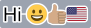
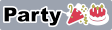

# textrude

Turn text and color emoji into **multi-color 3MF models** for 3D printing. Each color becomes its own part, already assigned to a filament. Opens directly in OrcaSlicer, Snapmaker Orca, and Bambu Studio. It can also export plain SVGs.

```sh
textrude "I ❤️ 3D printing 🎉" -f Helvetica --fallback-font ./fonts/twemoji.ttf -w 1.5 --connect --flip --printer snapmaker-u1 -o sign.3mf
```


## Printer profiles (filament colors)

OrcaSlicer-based slicers only read filament colors from a 3MF's project settings, and those must name the printer's real slicer presets. Otherwise opening the file would reset the printer's settings. So pass a printer profile:

- **Built-in:** `--printer snapmaker-u1`. You can also set it once with `export TEXTRUDE_PRINTER=snapmaker-u1`.
- **Any other printer:** give the exact preset names from your slicer with `--printer-preset`, `--process-preset`, and `--filament-preset`.
- **Overrides:** `--filament-preset`, `--process-preset`, and `--bed-type` also override the built-in profile's values.

With a profile, the 3MF opens with one filament per color, each already set to its color. The model is centered on that printer's bed. Without one, each part is still assigned to its filament number, but the slicer keeps its current filament list and colors.

The Snapmaker U1 has 4 toolheads. textrude warns if a design needs more, and `--max-colors 4` or `--palette` brings it down.

## Features

- **Any font**: installed font names, font files (TTF, OTF, TTC, WOFF, WOFF2), or URLs. Names are looked up in a local `./fonts` folder first.
- **Color emoji** become separate filament colors:
  - COLR vector fonts (Twemoji, OpenMoji) keep their exact colors.
  - Bitmap fonts (Apple Color Emoji, Noto Color Emoji, Blobmoji) are reduced to a few colors and traced into shapes.
  - Skin tones, flags, and ZWJ sequences (like 👨‍👩‍👧) work.
  - Emoji the main font lacks fall back to `--fallback-font`, or to an installed color emoji font.
- **Filament-aware colors**:
  - `--palette` maps every color to your loaded filaments, in slot order.
  - `--max-colors` merges similar colors.
  - `--letter-colors` cycles colors per letter.
- **Stroke/outline**, built as real geometry, so the color regions never overlap.
- **`--connect`** bridges separate pieces (letters, the dot on an i, ...) so the print comes out as one piece.
- **`--background`** puts a solid plate behind the design instead, which also holds everything together.
  - `--background-radius` rounds the corners. Like CSS `border-radius`, a huge radius gives a pill shape.
  - `--background-padding` sets the space around the design.
  - With a background, the stroke defaults to the background color, so it blends into the plate as one part.
  - Pass `--stroke-color` for a separately colored outline.
- **Bold, italic, underline, strikethrough.** Real font faces or variable-font axes are used when available, and synthesized otherwise.
- **`--flip`** to print face-down, so the visible side is the smooth surface that touched the build plate.
- **Config files** (`--config sign.json`) to save a design and re-run it.
- **Terminal preview**: shows an image of the result, plus a table of parts with their filament, color, height, and volume.
  - Terminals with native image support (iTerm2, Kitty, WezTerm, ...) show a full image; others get colored blocks.
  - `--preview-png out.png` saves the image.
  - `--no-preview` turns it off, and `-q` prints only errors.

## Setup

```sh
npm install
npm link        # puts `textrude` on your PATH (or run ./textrude.mjs directly)
textrude --help
```

## Examples

These images are SVG renders of each example (`--format svg`), shown on a gray backdrop. The 3MF versions have the same parts, extruded. `--flip` and part heights don't show in a flat image.

The emoji fonts are [Twemoji Mozilla](https://github.com/mozilla/twemoji-colr) and [OpenMoji](https://github.com/hfg-gmuend/openmoji). `npm run examples` downloads them into `./fonts`, then re-renders every image and updates this section.

<!-- examples:start -->
<!-- Generated by `npm run examples` (scripts/examples.mjs); edit the examples there. -->

### Black text on a 2mm white outline, connected into one piece

```sh
textrude Hello -f "Arial Black" -s 20 -w 2 --connect --flip -o hello.3mf
```


### Skin tones, flags, and an outline around everything

```sh
textrude "Hi 😀👍🏽🇺🇸" -f Helvetica --fallback-font ./fonts/twemoji.ttf -w 1.5 --connect -o hi.3mf
```



### Map every color onto the filaments loaded in slots 1-6

```sh
textrude "🦄🌈" -f ./fonts/openmoji.ttf -s 40 --palette white,black,pink,purple,gold,skyblue -o unicorn.3mf
```


### Merge similar colors to fit a 4-toolhead printer

```sh
textrude "Party 🎉🎂" -f "Arial Black" --fallback-font ./fonts/twemoji.ttf --max-colors 4 -w 1.5 --connect -o party.3mf
```



### White text on a pill-shaped navy plate

```sh
textrude "Hello 😀" -f "Arial Black" --fallback-font ./fonts/twemoji.ttf -c white --background navy --background-radius 999 -o pill.3mf
```


### A separately colored outline on the plate

```sh
textrude Stroke -f "Arial Black" -c white -w 2 --stroke-color gold --background navy --background-radius 999 -o outlined.3mf
```


### Raised text (3mm) on a 2mm plate with rounded corners

```sh
textrude Raised -f "Arial Black" --background gold --background-radius 3 --height 2 --text-height 3 -o raised.3mf
```


### A different color per letter

```sh
textrude Rainbow -f "Arial Black" --letter-colors red,orange,gold,green,blue,purple -w 1.5 --connect -o rainbow.3mf
```


### Multiple lines, centered

```sh
textrude "Hello\nWorld" -f Helvetica -b -w 2 --connect --align center -o hello-world.3mf
```


### Bold, italic, and underlined

```sh
textrude Hello -f Helvetica -b -i -u -w 1.5 --connect -o hello.3mf
```


### Outline only (hollow letters), one piece

```sh
textrude Wavy -f "Snell Roundhand" -s 25 -c none -w 1 --stroke-color black --connect -o wavy.3mf
```


### A font loaded straight from a URL

```sh
textrude Hello -f https://github.com/google/fonts/raw/main/ofl/pacifico/Pacifico-Regular.ttf -w 1.5 --connect -o hello.3mf
```


<!-- examples:end -->

## Config files

Any option can go in a JSON file, using either `--kebab-case` names or `camelCase`, plus `text`. Command-line flags override the file.

```json
{
  "text": "Party time 🎉",
  "font": "Arial Black",
  "fallbackFont": "./fonts/twemoji.ttf",
  "size": 25,
  "strokeWidth": 1.5,
  "connect": true,
  "flip": true,
  "palette": "black,white,red,gold"
}
```

```sh
textrude --config party.json -o party.3mf
```

## Notes

- Sizes are in mm. `--size` is the font's em size.
- **Filaments**:
  - With `--palette`, each part uses the slot of the palette color it was mapped to.
  - Otherwise, parts are numbered 1, 2, 3, ... by distinct color. Override them with `--text-filament`, `--stroke-filament`, and `--bridge-filament`.
  - The slicer uses whatever filament is loaded in each slot.
- **Emoji colors**:
  - Vector emoji keep every color by default, so a few emoji can easily use 10+ colors. Use `--palette` or `--max-colors` to fit your printer.
  - Bitmap emoji are reduced to `--bitmap-colors` (default 8) before tracing.
- **Bold and italic** try these in order:
  1. the family's real Bold/Italic face
  2. the variable font's `wght`, `ital`, or `slnt` axis
  3. a synthetic style (outlines thickened by 2% of the size, or a 12° slant)

  `--synthetic` forces the synthetic version, and `--embolden` and `--slant` set the amounts directly.
- If the bridges are the same color as the stroke (the default), they are merged into the stroke part.
- With `--flip`, all parts start flat on the bed, so different heights only change the back of the print.
- The object is placed at `--position`. By default that's the printer's bed center, or `100,100` without a printer profile. Press **A** (Arrange) in the slicer to re-center it.
- Not supported yet: COLRv1 fonts (gradients) and SVG-in-OpenType fonts.

## Credits

Emoji in the example images:
- [Twemoji](https://github.com/twitter/twemoji) © Twitter, Inc and other contributors, [CC BY 4.0](https://creativecommons.org/licenses/by/4.0/)
- [OpenMoji](https://openmoji.org) © the OpenMoji contributors, [CC BY-SA 4.0](https://creativecommons.org/licenses/by-sa/4.0/)
