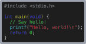

# textrude

Turn text and color emoji into **multi-color 3MF models** for 3D printing. Each color becomes its own part, already assigned to a filament. Opens directly in OrcaSlicer, Snapmaker Orca, and Bambu Studio. It can also export plain SVGs.

```sh
textrude "I ❤️ 3D printing 🎉" -f Helvetica --fallback-font ./fonts/twemoji.ttf -w 1.5 --connect --flip --printer snapmaker-u1 -o sign.3mf
```


## Printer profiles (filament colors)

OrcaSlicer-based slicers only read filament colors from a 3MF's project settings, and those must name the printer's real slicer presets. Otherwise opening the file would reset the printer's settings. So pass a printer profile:

- **Built-in:** `--printer snapmaker-u1`. You can also set it once with `export TEXTRUDE_PRINTER=snapmaker-u1`.
- **Any other printer:** give the exact preset names from your slicer with `--printer-preset`, `--process-preset`, and `--filament-preset`.
- **Overrides:** `--filament-preset`, `--process-preset`, and `--bed-type` also override the built-in profile's values.

With a profile, the 3MF opens with one filament per color, each already set to its color. The model is centered on that printer's bed. Without one, each part is still assigned to its filament number, but the slicer keeps its current filament list and colors.

The Snapmaker U1 has 4 toolheads. textrude warns if a design needs more, and `--max-colors 4` or `--palette` brings it down.

## Features

- **Any font**: installed font names, font files (TTF, OTF, TTC, WOFF, WOFF2), or URLs. Names are looked up in a local `./fonts` folder first.
- **Bitmap fonts** in [BMFont](https://www.angelcode.com/products/bmfont/) format, the common format for game and pixel fonts: pass the `.fnt` (its page images are read from beside it) or a `.zip` of the `.fnt` and its pages. Glyphs are traced into outlines: smooth curves for large anti-aliased glyphs, exact pixel squares for small or 1-bit ones.
- **Color emoji** become separate filament colors:
  - COLR vector fonts (Twemoji, OpenMoji) keep their exact colors.
  - Bitmap fonts (Apple Color Emoji, Noto Color Emoji, Blobmoji) are reduced to a few colors and traced into shapes.
  - Skin tones, flags, and ZWJ sequences (like 👨‍👩‍👧) work.
  - Emoji the main font lacks fall back to `--fallback-font`, or to an installed color emoji font.
- **Text from arguments, a config file, or stdin**:
  - Pipe text in, or pass `-` to read stdin.
  - Newlines start new lines: pipe a file, or use the shell's `$'Hello\nWorld'`.
  - Tabs become 4 spaces.
- **ANSI colors** become filament colors: syntax-highlighted code, `lolcat -f` output, or any `\e[31m`-style colored text.
  - Basic, 256-color, and truecolor codes are supported.
  - Other escape sequences are ignored.
- **Filament-aware colors**:
  - `--palette` maps every color to your loaded filaments, in slot order.
  - `--max-colors` merges similar colors.
  - `--letter-colors` cycles colors per letter.
- **Stroke/outline**, built as real geometry, so the color regions never overlap.
- **`--connect`** bridges separate pieces (letters, the dot on an i, ...) so the print comes out as one piece.
- **`--background`** puts a solid plate behind the design instead, which also holds everything together.
  - `--background-radius` rounds the corners. Like CSS `border-radius`, a huge radius gives a pill shape.
  - `--background-padding` sets the space around the design.
  - With a background, the stroke defaults to the background color, so it blends into the plate as one part.
  - Pass `--stroke-color` for a separately colored outline.
  - `--raised` puts the text (and outline) on top of the plate instead of inset into it, so the back of the print shows only the plate. `--text-height` and `--stroke-height` are then how far they stand above it.
- **Bold, italic, underline, strikethrough.** Real font faces or variable-font axes are used when available, and synthesized otherwise.
- **`--flip`** to print face-down, so the visible side is the smooth surface that touched the build plate. `--flush` picks which side stays flat when parts have different heights (see [Heights](#heights)).
- **Multiple texts** (`-t Alice -t Bob`) become separate objects on one plate, spaced apart so they print separately.
- **Config files** (`--config sign.json`) to save a design and re-run it.
- **Terminal preview**: shows an image of the result, plus a table of parts with their filament, color, height, and volume.
  - Terminals with native image support (iTerm2, Kitty, WezTerm, ...) show a full image; others get colored blocks.
  - `--preview-png out.png` saves the image.
  - `--no-preview` turns it off, and `-q` prints only errors.

## Install

Requires Node.js 22.4 or newer.

```sh
npm install -g textrude
textrude --help

# or without installing:
npx textrude "Hello" -o hello.3mf
```

## JavaScript API

The CLI is a thin wrapper around `textrude()`, which takes the same options (in camelCase):

```ts
import fs from 'node:fs';
import { textrude } from 'textrude';

const result = await textrude('Hello 😀', {
  font: 'Arial Black',
  fallbackFonts: ['./fonts/twemoji.ttf'],
  strokeWidth: 1.5,
  connect: true,
  onLog: (e) => console.error(e.level, e.message),
});

for (const part of result.parts) console.log(part.filament, part.color, part.roles);

fs.writeFileSync('hello.3mf', result.to3MF({ printer: 'snapmaker-u1', flip: true }));
fs.writeFileSync('hello.svg', result.toSVG());
fs.writeFileSync('hello.png', result.toPNG());
```

`arrange()` lays out several results as separate objects on one plate. The plate has the same `to3MF()`, `toSVG()`, and `toPNG()` methods:

```ts
import { arrange, textrude } from 'textrude';

const names = await Promise.all(['Alice', 'Bob', 'Carol'].map((name) => textrude(name, { strokeWidth: 1.5, connect: true })));
const plate = arrange(names, { gap: 5, maxWidth: 270 });
fs.writeFileSync('names.3mf', plate.to3MF({ printer: 'snapmaker-u1' }));
```

Invalid input throws a `TextrudeError`.

### In the browser

The library also runs in browsers (and other runtimes without a file system). There are no installed fonts there, so pass each font as a URL or as the font file's contents:

```ts
import { textrude } from 'textrude';

const font = new Uint8Array(await (await fetch('/fonts/Inter.ttf')).arrayBuffer());
const result = await textrude('Hello', { font, strokeWidth: 1.5, connect: true });

// Each part's triangle mesh, the same geometry as in the 3MF: e.g. for a three.js preview.
for (const { part, positions, indices } of result.toMeshes()) console.log(part.color, positions.length / 3, indices.length / 3);

const blob = new Blob([result.to3MF()], { type: 'model/3mf' });
```

Passing the same `Uint8Array` again reuses the parsed font. [`examples/browser`](examples/browser) is a web app built this way, with a live 3D preview.

## Examples

These images are SVG renders of each example (`--format svg`), shown on a gray backdrop. The 3MF versions have the same parts, extruded. `--flip`, `--raised`, and part heights don't show in a flat image.

The emoji fonts are [Twemoji Mozilla](https://github.com/mozilla/twemoji-colr) and [OpenMoji](https://github.com/hfg-gmuend/openmoji). `pnpm run examples` downloads them into `./fonts`, then re-renders every image and updates this section.

<!-- examples:start -->
<!-- Generated by `pnpm run examples` (scripts/examples.mjs); edit the examples there. -->

### Black text on a 2mm white outline, connected into one piece

```sh
textrude Hello -f "Arial Black" -s 20 -w 2 --connect --flip -o hello.3mf
```


### Skin tones, flags, and an outline around everything

```sh
textrude "Hi 😀👍🏽🇺🇸" -f Helvetica --fallback-font ./fonts/twemoji.ttf -w 1.5 --connect -o hi.3mf
```


### Map every color onto the filaments loaded in slots 1-6

```sh
textrude "🦄🌈" -f ./fonts/openmoji.ttf -s 40 --palette white,black,pink,purple,gold,skyblue -o unicorn.3mf
```


### Merge similar colors to fit a 4-toolhead printer

```sh
textrude "Party 🎉🎂" -f "Arial Black" --fallback-font ./fonts/twemoji.ttf --max-colors 4 -w 1.5 --connect -o party.3mf
```


### White text on a pill-shaped navy plate

```sh
textrude "Hello 😀" -f "Arial Black" --fallback-font ./fonts/twemoji.ttf -c white --background navy --background-radius 999 -o pill.3mf
```


### A separately colored outline on the plate

```sh
textrude Stroke -f "Arial Black" -c white -w 2 --stroke-color gold --background navy --background-radius 999 -o outlined.3mf
```


### Raised text (3mm) on a 2mm plate with rounded corners

```sh
textrude Raised -f "Arial Black" --background gold --background-radius 3 --height 2 --text-height 3 -o raised.3mf
```


### A different color per letter

```sh
textrude Rainbow -f "Arial Black" --letter-colors red,orange,gold,green,blue,purple -w 1.5 --connect -o rainbow.3mf
```


### Multiple lines, centered

```sh
textrude $'Hello\nWorld' -f Helvetica -b -w 2 --connect --align center -o hello-world.3mf
```


### Syntax-highlighted code: ANSI colors on stdin become filament colors

```sh
FORCE_COLOR=1 npx cli-highlight examples/hello.c | textrude -f Menlo -s 8 -c "#d4d4d4" --background "#1e1e1e" --background-radius 3 --background-padding 4 -o hello-c.3mf
```



### Any ANSI-colored text works, including 256-color and truecolor codes

```sh
printf '\033[91mRed \033[92mGreen \033[94mBlue \033[38;2;255;140;0mOrange' | textrude -f "Arial Black" -w 1.5 --connect -o ansi.3mf
```


### Several texts as separate objects, spaced apart on one plate

```sh
textrude -f "Arial Black" -w 1.5 --connect -t Alice -c red -t Bob -c blue -t Carol -c green -o names.3mf
```


### Bold, italic, and underlined

```sh
textrude Hello -f Helvetica -b -i -u -w 1.5 --connect -o hello.3mf
```


### Outline only (hollow letters), one piece

```sh
textrude Wavy -f "Snell Roundhand" -s 25 -c none -w 1 --stroke-color black --connect -o wavy.3mf
```


### A font loaded straight from a URL

```sh
textrude Hello -f https://github.com/google/fonts/raw/main/ofl/pacifico/Pacifico-Regular.ttf -w 1.5 --connect -o hello.3mf
```


<!-- examples:end -->

## Multiple texts

Each `-t` / `--text` adds a separate object to the plate. Every object has its own parts, one per color:

```sh
textrude -f "Arial Black" -w 1.5 --connect \
  -t Alice -c red \
  -t Bob -c blue \
  -t Carol -c green \
  --printer snapmaker-u1 -o names.3mf
```

- Options before the first `-t` apply to every text. Options after a `-t` apply only to that text, and override the shared ones.
- Options for the whole file can go anywhere: `-o`, `--printer`, `--palette`, `--flip`, `--flush`, `--position`, and so on.
- The objects are laid out left to right, `--gap` mm apart (default 5). A new row starts when a row would get wider than the printer's bed (200 mm without a printer profile).
- A color uses the same filament slot in every object.
- `-t -` reads that text from stdin.

## Config files

Any option can go in a JSON file, using either `--kebab-case` names or `camelCase`, plus `text`. Command-line flags override the file.

```json
{
  "text": "Party time 🎉",
  "font": "Arial Black",
  "fallbackFont": "./fonts/twemoji.ttf",
  "size": 25,
  "strokeWidth": 1.5,
  "connect": true,
  "flip": true,
  "palette": "black,white,red,gold"
}
```

```sh
textrude --config party.json -o party.3mf
```

For several texts, use a `texts` array instead of `text`. Each entry is a string, or an object with its own options. The top-level options are shared by all of them. Texts given with `-t` replace the file's `texts`.

```json
{
  "font": "Arial Black",
  "strokeWidth": 1.5,
  "connect": true,
  "texts": ["Alice", { "text": "Bob", "color": "blue" }, { "text": "Carol 🎉", "size": 30 }]
}
```

## Heights

Every part is `--height` tall (default 2 mm), unless `--text-height`, `--stroke-height`, `--bridge-height`, or `--background-height` say otherwise. How parts of different heights fit together depends on three options:

- **`--raised`** (with `--background`): the text and outline sit on top of a solid plate, instead of being inset into it. The back of the print shows only the plate.
- **`--flip`** turns the model over, so its face prints on the build plate.
- **`--flush face|back`** is the side that stays flat. With `back`, taller parts stand out of the face; with `face`, they stick out of the back. It defaults to the side on the build plate: `back`, or `face` with `--flip`.

For example, with 3 mm text on a 2 mm plate:

| Options | Text | Plate | Result |
| --- | --- | --- | --- |
| (none) | 0–3 mm | 0–2 mm | The text stands 1 mm out of the face. |
| `--flip` | 0–3 mm | 0–2 mm | The face is flat on the bed; the text sticks 1 mm out of the back. |
| `--flip --flush back` | 0–3 mm | 1–3 mm | The text stands out of the face, printed face-down. The plate starts 1 mm up, so it needs supports. |

And with `--raised --text-height 1` on a 2 mm plate:

| Options | Text | Plate | Result |
| --- | --- | --- | --- |
| `--raised` | 2–3 mm | 0–2 mm | The text sits on the plate. |
| `--raised --flip` | 0–1 mm | 1–3 mm | The text prints first, flat on the bed, and the plate is printed over it. The plate bridges the gaps between letters. |

## Notes

- Sizes are in mm. `--size` is the font's em size.
- **Filaments**:
  - With `--palette`, each part uses the slot of the palette color it was mapped to.
  - Otherwise, parts are numbered 1, 2, 3, ... by distinct color. Override them with `--text-filament`, `--stroke-filament`, and `--bridge-filament`.
  - The slicer uses whatever filament is loaded in each slot.
- **Emoji colors**:
  - Vector emoji keep every color by default, so a few emoji can easily use 10+ colors. Use `--palette` or `--max-colors` to fit your printer.
  - Bitmap emoji are reduced to `--bitmap-colors` (default 8) before tracing.
- **Bold and italic** try these in order:
  1. the family's real Bold/Italic face
  2. the variable font's `wght`, `ital`, or `slnt` axis
  3. a synthetic style (outlines thickened by 2% of the size, or a 12° slant)

  `--synthetic` forces the synthetic version, and `--embolden` and `--slant` set the amounts directly.
- If the bridges are the same color as the stroke (the default), they are merged into the stroke part.
- The object (or the group of objects, for multiple texts) is centered at `--position`. By default that's the printer's bed center, or `100,100` without a printer profile. Press **A** (Arrange) in the slicer to re-center it.
- **Bitmap fonts** (BMFont) are converted to an outline font with [`@tootallnate/bitmap-font`](https://github.com/TooTallNate/switch-tools/tree/main/packages/bitmap-font). Only the glyph shapes are used, not their colors. A glyph's detail is limited by its pixels, so use the largest size the font comes in.
- Not supported yet: COLRv1 fonts (gradients) and SVG-in-OpenType fonts.

## Development

```sh
pnpm install
pnpm run build       # compile src/ (TypeScript) to dist/
pnpm run typecheck
pnpm test            # vitest
node dist/bin.js --help
```

- **Tests** run on small font subsets in `test/fixtures/fonts`, so they don't need any system fonts.
  - Every rendered design is checked for watertight, manifold, outward-facing meshes.
  - A few regression tests use macOS system fonts and are skipped elsewhere; CI runs them on macOS.
- **Releases** are managed with [Changesets](https://github.com/changesets/changesets):
  1. Add a changeset (`pnpm changeset`) to any pull request that changes the package.
  2. On `main`, the release workflow opens a "Version Packages" pull request.
  3. Merging it publishes to npm through trusted publishing (OIDC), with no npm token.

## Credits

Emoji in the example images:
- [Twemoji](https://github.com/twitter/twemoji) © Twitter, Inc and other contributors, [CC BY 4.0](https://creativecommons.org/licenses/by/4.0/)
- [OpenMoji](https://openmoji.org) © the OpenMoji contributors, [CC BY-SA 4.0](https://creativecommons.org/licenses/by-sa/4.0/)
